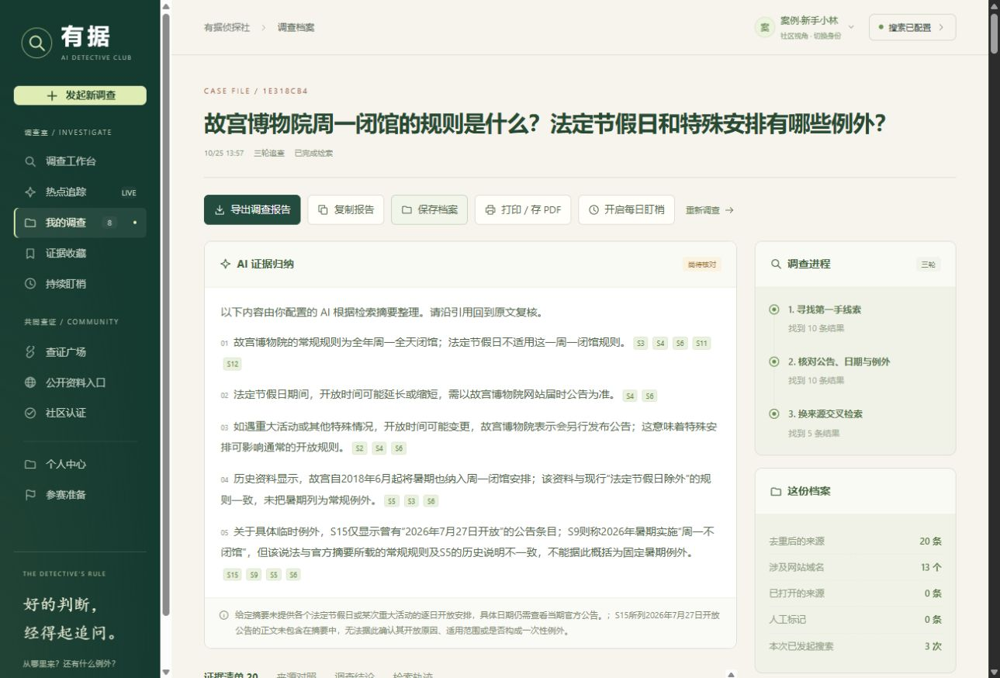

# 有据 · AI 侦探社

把一个生活疑问，查成**有来源、有过程、能复核**的调查档案。

不是"问一句、答一句"的聊天框，而是一台本机运行的调查工作台：你提出一个说法，它去搜、把每轮请求编号记下来、给每条来源标注发布时间与抓取时间、最后导出一份可逐条核对的档案。



---

## 它能做什么

| 能力 | 说明 |
| --- | --- |
| **三轮追查** | 同一问题分轮检索，每轮请求都有编号、关键词和时间戳，过程可回放 |
| **来源可核** | 每条来源标注站域名、源站发布时间、本地获取时间，附原文链接 |
| **截图取证** | 支持上传截图识别，抽取其中的说法逐条比对来源 |
| **AI 归纳** | 可对接兼容模型接口做摘要与说法抽取；不配也能正常搜索、人工判断、导出 |
| **查证广场** | 带来源的讨论区，四种案例身份可免密码切换体验 |
| **热点追踪** | 读取 IT之家、NASA 等公开订阅源的实时图文，标注入库时间 |

## 快速开始

要求：**Node.js ≥ 20.3**，**零第三方依赖**。

```bash
git clone https://github.com/<你的用户名>/youju-ai-detective-agency.git
cd youju-ai-detective-agency
node server.mjs
```

启动后打开终端里显示的地址（默认 <http://127.0.0.1:4318>）。

Windows 用户也可以直接双击根目录的 `一键启动.bat`，脚本会自动起服务并打开浏览器。

换端口：`node server.mjs --port 5000`。

## 配置 API Key

不配置也能用：搜索、人工判断、导出档案这些核心流程不依赖 AI。

要启用"连接元宝搜索"和 AI 归纳，在页面右上角点击**「连接元宝搜索」**，填入你自己的服务 API Key。Key 只在本机请求中使用，不会随仓库公开。也可以在启动前预设环境变量：

```bash
export TENCENTCLOUD_WSA_APIKEY=你的Key
node server.mjs
```

## 目录结构

```
lib/         服务端能力：search 搜索、ai 归纳、community 社区、hotspots 热点、accounts 账户
public/      前端页面与脚本，原生 JS + CSS，无构建步骤
tests/       node:test 用例，覆盖搜索、社区、账户、UI
提交材料/    三次真实查询的原始档案、截图、Markdown 报告与离线演示索引
server.mjs   纯 Node 原生 HTTP 服务，默认监听 127.0.0.1:4318
```

## 跑测试

```bash
npm test
```

## 安全设计

- 只绑定 `127.0.0.1`，并且校验 Host 白名单，外部地址访问一律 403
- 严格 CSP：`script-src 'self'`、`frame-ancestors 'none'`、`object-src 'none'`
- 会话 Cookie 为 `HttpOnly` + `SameSite=Strict`
- POST 请求校验 Origin 与 Content-Type，限制请求体大小，并发上限 3
- 账户库只写本机 `.youju-data/`，该文件目录已被 `.gitignore` 排除，不会进仓库

## 使用边界

- 这是**本机运行**的作品。`127.0.0.1` 是你自己的本机地址，别人无法通过作者电脑的地址远程访问。
- 来源摘要、AI 归纳、社区身份**都不等于事实认证**。请打开原文核对日期与适用条件。
- 案例用户是演示身份，不具备管理员权限或真实专业资质认证。
- 热点快讯来自 IT之家、NASA 的公开订阅，并非全网热榜。

更详细的操作见 [`使用说明.md`](使用说明.md)，比赛与演示说明见 [`参赛演示与提交.md`](参赛演示与提交.md)，三次真实查询的完整档案见 [`提交材料/演示索引.html`](提交材料/演示索引.html)。

## 许可证

[MIT](LICENSE)
